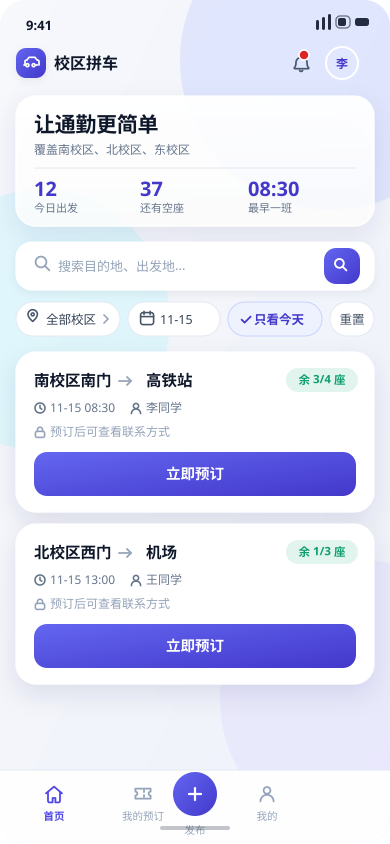
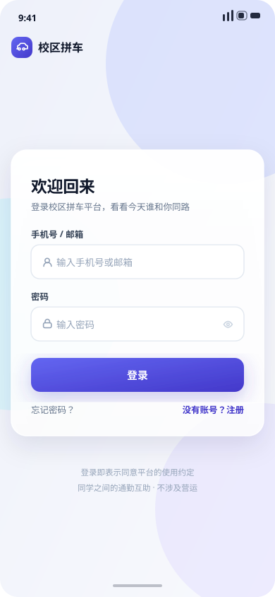
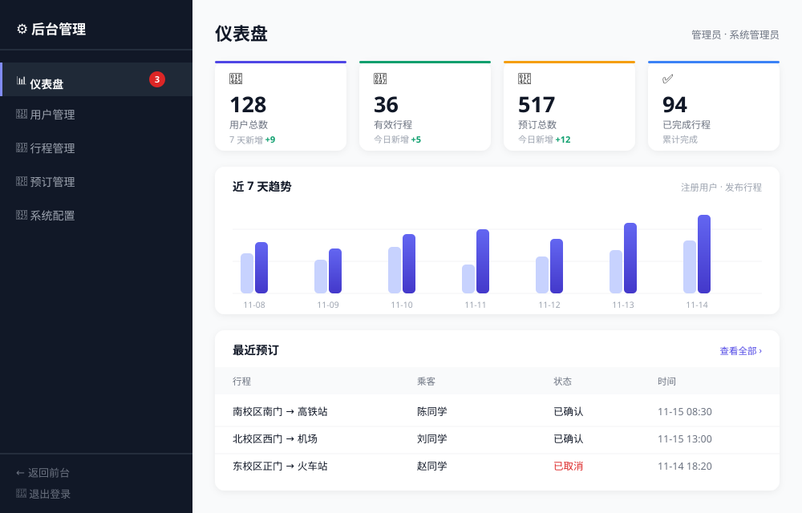

<p align="center">
  <br>
  
  
  
  
  <br>
</p>

<div align="center">

# 🚗 校区拼车平台

**面向校园的通勤拼车信息共享平台 · 让出行更简单**

[功能特性](#-功能特性) •
[页面预览](#-页面预览) •
[快速开始](#-快速开始) •
[项目结构](#-项目结构) •
[认证模式](#-认证模式可选) •
[安全设计](#-安全设计) •
[常见问题](#-常见问题)

</div>

---

## 📋 项目简介

校区拼车平台是一个面向高校师生的拼车信息共享平台。学生可以发布从校区到火车站、机场等目的地的拼车信息，也可以预订他人的行程，实现校内通勤的资源共享。

### 🎯 解决的问题

| 问题 | 说明 |
|------|------|
| 🚶 **出行不便** | 校区分散，公共交通耗时长，打车成本高 |
| 💺 **资源浪费** | 私家车空跑率高，座位大量闲置 |
| 📱 **信息分散** | 拼车信息散落在微信群/QQ群，难以查找和管理 |

### 🧱 技术栈

纯 **PHP + MySQL**，没有框架、没有构建步骤、没有 Composer 依赖——把文件放上服务器改个配置就能跑。
前端是手写的 HTML / CSS / JS（移动优先，玻璃质感样式表 `glass.css`），图标用内联的 Lucide SVG sprite，
**不请求任何外部 CDN**，断网环境、内网部署都能正常显示。

---

## ✨ 功能特性

### 👤 用户端

| 功能 | 说明 |
|------|------|
| 📱 注册 / 登录 | 手机号 + 邮箱双凭据；密码登录、邮箱验证码注册与找回密码 |
| 🚗 发布行程 | 路线一键交换、时间用系统选择器、默认带出上一次的行程、字段级就地报错 |
| 📌 预订行程 | 底部滑出确认面板，座位数实时更新，满员自动关闭预订 |
| 🔒 隐私保护 | 只有预订成功的人才能看到发起人的联系方式 |
| 👤 个人中心 | 看板式布局：身份卡 + 账号安全评分 + 「即将出行 / 我的发布 / 消息」分段切换 |
| ⚙️ 资料页 | 性别 / 校区选完即存；账号与安全可点行跳转；帮助与反馈；注销账号 |
| 🔔 通知中心 | 站内通知 + 邮件通知（预订 / 取消 / 满员 / 行程取消） |
| 📣 首页公告 | 后台可配标题与正文（支持 HTML），支持「只弹一次 / 每天一次 / 每次都弹」 |

### ⚙️ 管理端

| 功能 | 说明 |
|------|------|
| 📊 仪表盘 | 用户数、行程数、预订数一目了然 |
| 👥 用户管理 | 查看 / 禁用 / 启用用户 |
| 🚗 行程管理 | 浏览全部行程记录 |
| 📌 预订管理 | 查看全部预订流水 |
| 🔧 系统配置 | 首页公告、邮件通知开关 |

### 🔌 可选扩展（默认关闭，不影响开箱即用）

| 扩展 | 说明 |
|------|------|
| 🪪 统一身份认证 | 接入 Casdoor / 标准 OIDC，支持单点登录、单点登出、资料与头像同步、删除用户同步（Webhook） |
| 📱 微信小程序 | `api/v1/` 提供行程、预订、通知、用户、订阅消息等接口 + token 登录态（token 走 `Authorization: Bearer`，不接受 URL 参数） |
| ✉️ 微信订阅消息 | 预订成功 / 取消 / 行程提醒的模板消息推送 |

---

## 📱 页面预览

<div align="center">
  <table>
    <tr>
      <td align="center" width="33%">
        <br>
        <sub><b>🏠 首页</b> — 今日概况、滑动筛选、行程卡片</sub>
      </td>
      <td align="center" width="33%">
        <br>
        <sub><b>🔑 登录页</b> — 手机号 / 邮箱登录</sub>
      </td>
      <td align="center" width="33%">
        <br>
        <sub><b>⚙️ 管理后台</b> — 数据仪表盘</sub>
      </td>
    </tr>
  </table>
</div>

---

## 🚀 快速开始

### 环境要求

| 项目 | 要求 |
|------|------|
| Web 服务器 | Nginx 1.18+ / Apache 2.4+ |
| PHP | **8.0** / **8.1** / **8.2**（推荐 8.1；代码用到 `match` 与 `str_starts_with`，7.4 跑不起来） |
| 数据库 | MySQL 5.7+ / MariaDB 10.3+ |
| PHP 扩展 | `pdo_mysql`、`openssl`、`mbstring` |

### 安装步骤

```bash
# 1. 克隆项目
git clone https://github.com/your-username/carpool-campus.git
cd carpool-campus

# 2. 创建本地配置（敏感信息单独存放，不会被 Git 追踪）
cp config.local.example.php config.local.php

# 3. 导入数据库（全新安装用这一个文件即可，会自动建表并插入默认管理员）
mysql -u root -p your_database_name < setup.sql

# 4. 把 Web 服务器根目录指向项目文件夹，访问 http://your-domain.com
```

<details>
<summary><b>📝 编辑 config.local.php 填入你的配置</b></summary>

```php
// ===== 数据库配置 =====
define('DB_HOST', 'localhost');
define('DB_NAME', 'your_database_name');        // 数据库名
define('DB_USER', 'your_database_user');        // 数据库用户名
define('DB_PASS', 'your_database_password');    // 数据库密码

// ===== 邮件配置 (SMTP) =====
define('MAIL_HOST', 'smtp.office365.com');      // SMTP 服务器
define('MAIL_PORT', 587);                        // 端口
define('MAIL_SECURE', 'tls');                    // tls / ssl
define('MAIL_USERNAME', 'your@email.com');       // 邮箱地址
define('MAIL_PASSWORD', 'your_app_password');    // SMTP 授权码/应用密码
```

> 🔑 **邮件配置说明**：Outlook 用「应用密码」，QQ 邮箱 / 163 邮箱用「授权码」，都不是登录密码。
> 验证码邮件依赖此配置；暂时不需要的话可以留空，并在后台「系统配置」里关掉邮件通知。

</details>

### ⚡ 默认管理员

| 角色 | 邮箱 | 密码 |
|------|------|------|
| 🔑 超级管理员 | `admin@campus.com` | `admin123456` |

> ⚠️ **安全提醒**：部署后请**立即登录后台修改管理员邮箱和密码**，并同步改掉数据库密码。

### 🔄 已有站点升级

如果是从早期版本升级，**不要**执行 `setup.sql`（会删表重建），按顺序执行迁移脚本：

```bash
mysql -u root -p your_database_name < migrate_v2.sql    # 新字段
mysql -u root -p your_database_name < migrate_v3.sql
mysql -u root -p your_database_name < migrate_v4.sql
mysql -u root -p your_database_name < migrate_v5.sql    # 统一认证字段（casdoor_id / auth_source / avatar）
# 需要小程序 / 微信订阅消息时再执行：
# mysql -u root -p your_database_name < setup_miniprogram.sql
# mysql -u root -p your_database_name < setup_subscribe.sql
```

各版本改了什么见 [CHANGELOG.md](CHANGELOG.md)。

---

## 📁 项目结构

```
carpool-campus/
├── admin/                       # 后台管理模块（独立外观，不加载 glass.css）
│   ├── index.php                # 📊 仪表盘
│   ├── users.php                # 👥 用户管理
│   ├── rides.php                # 🚗 行程管理
│   ├── bookings.php             # 📌 预订管理
│   ├── config.php               # 🔧 系统配置（公告 + 通知）
│   ├── header.php / footer.php  # 后台公共模板
│
├── api/
│   ├── send_code.php            # 网页端验证码发送接口
│   └── v1/                      # 小程序接口（可选）
│       ├── auth_v2.php          # 登录 / 微信绑定 / 统一认证登录
│       ├── rides.php            # 行程列表与详情
│       ├── bookings.php         # 预订与取消
│       ├── notifications.php    # 通知
│       ├── users.php            # 个人资料
│       ├── subscribe.php        # 订阅消息授权
│       ├── subscribe_send.php   # 订阅消息发送
│       └── utils.php            # token 校验等公共函数
│
├── assets/
│   ├── css/app.css              # 基础样式（前后台共用）
│   ├── css/glass.css            # 玻璃质感样式表（前台全站）
│   └── js/app.js                # 全局交互脚本
│
├── lib/
│   └── casdoor.php              # 统一身份认证封装（OIDC 授权、token、资料同步）
├── oauth/                       # 统一身份认证入口（可选，AUTH_MODE=local 时不启用）
│   ├── login.php                # 发起授权（state + PKCE）
│   ├── callback.php             # 授权回调
│   ├── logged_out.php           # 单点登出落地页
│   └── casdoor_webhook.php      # 接收删除 / 修改用户事件
│
├── config.php                   # 主配置（站点名、校区列表、认证模式、限流参数）
├── config.local.example.php     # 🌟 本地配置模板（部署时复制为 config.local.php）
├── config.local.php             # ❌ 本地敏感配置（已加入 .gitignore）
├── functions.php                # 工具函数库（鉴权、通知、邮件、公告、渲染辅助）
├── header.php / footer.php      # 前台公共模板（图标 sprite / 标签栏 / 交互脚本）
│
├── index.php                    # 🏠 首页（行程列表 + 搜索筛选 + 预订面板 + 公告）
├── login.php                    # 🔑 登录
├── register.php                 # 📝 注册
├── logout.php                   # 🚪 退出登录
├── forgot_password.php          # 🔄 找回密码
│
├── post_ride.php                # 🚗 发布行程
├── book_ride.php                # 📌 预订行程
├── cancel_booking.php           # ↩️ 取消预订
├── delete_ride.php              # 🗑️ 删除行程
│
├── my_rides.php                 # 📋 我的发布
├── my_bookings.php              # 📋 我的预订
├── user_center.php              # 👤 个人中心（看板）
├── profile.php                  # ⚙️ 资料页（基本资料 / 账号安全 / 注销）
├── delete_account.php           # 注销账号处理
│
├── setup.sql                    # 🗄️ 数据库初始化（全新安装）
├── migrate_v2~v5.sql            # 🔼 老站点升级脚本
├── setup_miniprogram.sql        # 🔼 小程序支持（可选）
├── setup_subscribe.sql          # 🔼 微信订阅消息支持（可选）
│
├── screenshots/                 # 页面预览图
├── 404.html                     # 404 页面
├── CHANGELOG.md                 # 版本记录与开发笔记
├── DEPLOY.md                    # 部署指南
├── .gitignore                   # Git 忽略规则
└── README.md                    # 📖 本文件
```

---

## 🪪 认证模式（可选）

默认走**本地账号体系**：`config.php` 里 `AUTH_MODE = 'local'`，不依赖任何外部服务。
想接入统一身份认证（Casdoor 或任何标准 OIDC 服务）时，有三档可选：

| `AUTH_MODE` | 行为 |
| --- | --- |
| `local`（默认） | 只用本机手机号 / 邮箱 + 密码登录，注册与找回密码也在本机完成 |
| `both` | 同时提供统一认证登录与本机登录（迁移期常用） |
| `casdoor` | 完全切到统一认证，`register.php` / `forgot_password.php` 直接跳转认证平台 |

接入步骤：

1. 在认证平台新建应用，回调地址填 `https://你的域名/oauth/callback.php`，
   登出回跳地址填 `https://你的域名/oauth/logged_out.php`；
2. `config.local.php` 里填 `CASDOOR_BASE`、`CASDOOR_CLIENT_ID`、`CASDOOR_CLIENT_SECRET`，
   想用删除同步再填 `CASDOOR_WEBHOOK_SECRET`；
3. 把 `AUTH_MODE` 改成 `casdoor` 或 `both`；
4. 数据库执行 `migrate_v5.sql`。

接入后支持：单点登录 / 单点登出、昵称与头像同步、手机号与邮箱回填、Webhook 删除用户同步。
不需要时把 `AUTH_MODE` 改回 `local` 即可完整回滚，`oauth/` 里的文件不参与本地登录流程。

---

## 🔒 安全设计

```
✅ 密码加密          → bcrypt（cost=10）哈希存储
✅ CSRF 防护         → 所有 POST 表单校验 Token
✅ SQL 注入防护      → 全量 PDO 参数化查询，关闭模拟预处理
✅ XSS 防护          → 输出统一走 h() 转义；公告 HTML 仅管理员可写
✅ 频率限制          → 登录 / 注册 / 验证码 / 找回密码均有 IP 级限流
✅ 会话安全          → 登录后重新生成 session_id；Cookie 带 HttpOnly + SameSite，HTTPS 下加 Secure
✅ 权限校验          → 后台页面强制管理员身份，前台操作校验资源归属
✅ 隐私保护          → 联系方式只对预订成功的用户可见
✅ 敏感操作确认      → 注销账号需再输一次密码（本机账号模式）
✅ 账号枚举防护      → 找回密码不透露邮箱是否注册过
✅ 敏感信息隔离      → 密码 / 密钥全部放 config.local.php，不进版本库
```

### 敏感信息管理

```
config.local.php       ← ❌ 不上传 Git（数据库密码 / 邮箱授权码 / 应用密钥）
config.php             ← ✅ 上传 Git（通用配置，不含任何密钥）
```

---

## 📧 邮件与通知

平台在以下场景会自动发送邮件通知（需配置 SMTP，可在后台开关）：

| 场景 | 通知对象 | 说明 |
|------|---------|------|
| ✅ 预订成功 | 乘客 + 发起人 | 双方确认行程 |
| ❌ 取消预订 | 乘客 + 发起人 | 座位自动释放 |
| 🚗 行程满员 | 发起人 + 所有乘客 | 可确认行程 |
| 🚫 行程取消 | 发起人 + 所有乘客 | 行程终止通知 |
| 🔢 验证码 | 注册 / 找回密码用户 | 身份验证 |

站内通知与邮件互不影响：邮件发不出去，站内通知照常。

---

## ❓ 常见问题

<details>
<summary><b>验证码收不到邮件？</b></summary>

1. 检查垃圾邮件箱
2. 确认 `config.local.php` 里的 SMTP 配置正确（代码读这个文件，不读数据库）
3. 确认使用的是 **应用密码 / 授权码** 而非登录密码
4. 检查服务器防火墙是否允许 SMTP 端口的**出站**连接
5. 查看 PHP 错误日志
</details>

<details>
<summary><b>页面 500 / 白屏？</b></summary>

1. 查看 PHP 错误日志（宝塔：网站 → 设置 → 日志）
2. 确认 `config.local.php` 存在且数据库信息正确
3. 确认数据库已导入 `setup.sql`（老站点按 `migrate_v2~v5.sql` 升级过）
4. 确认 PHP 已启用 `pdo_mysql` 扩展
</details>

<details>
<summary><b>新上传的文件打开是 403？</b></summary>

文件权限问题：**文件 644、目录 755**，属主为 Web 服务用户（如 `www`）。参见 [CHANGELOG v1.0.1](CHANGELOG.md)。
</details>

<details>
<summary><b>改了 CSS / JS 但手机上看不到变化？</b></summary>

静态资源引用带版本号（`glass.css?v=5`）。改完样式请同步把 `header.php` 里的 `?v=` 加一，
否则手机会一直用缓存里的旧文件。
</details>

<details>
<summary><b>忘记管理员密码怎么办？</b></summary>

SSH 登录服务器后用 MySQL 直接重置：

```sql
-- 先在 PHP 里生成新密码的哈希
-- php -r "echo password_hash('新密码', PASSWORD_BCRYPT);"
UPDATE users SET password_hash = '生成的哈希值' WHERE email = 'admin@campus.com';
```
</details>

<details>
<summary><b>不想用统一认证，会不会少了什么？</b></summary>

不会。`AUTH_MODE = 'local'` 时注册、登录、找回密码、资料编辑、注销全部在本机完成，
`oauth/` 与 `lib/casdoor.php` 不被调用；只是「账号与安全」里的几行在本地模式下就只是展示，
不提供跳转认证平台的入口。
</details>

---

## 📄 许可证

[MIT](LICENSE)

---

<p align="center">
  用 ❤️ 为校园出行而建
</p>
